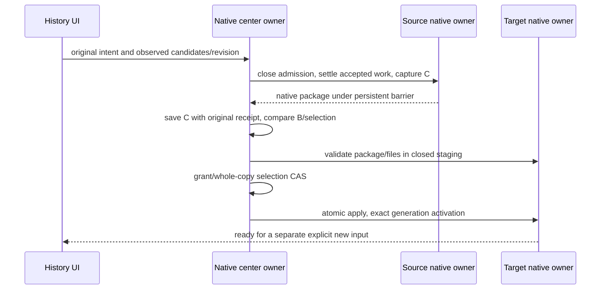
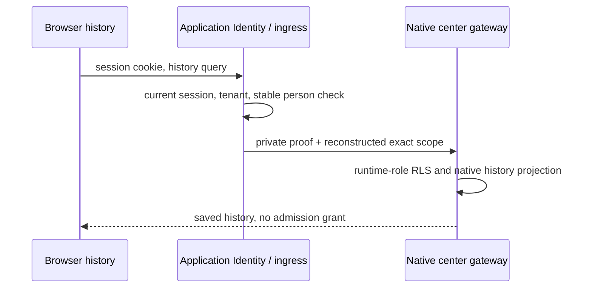

# Conversation sync center — isolated development contract

## Scope and owner

The native conversation storage owner exposes `@zcode/adapters/conversation-sync`.
It owns immutable versions, scoped payload deduplication, operation receipts,
selection and handoff facts. Enterprise services supply authenticated scope and
resource authorization; they never inspect native SQLite or write conversation
rows. The first codec reuses `textCheckpointSchema`, with no second text DTO.
Unknown/non-text states remain unsupported; existing session/plugin/configuration
stores are never replaced by a center database. This is an additive schema.

The initial facade is for trusted local assembly and isolated verification. It
is not a public HTTP endpoint, nor proof of Desktop/Web input integration. Scope,
qualification and source barrier evidence must come from trusted native owners,
not from browser JSON. No activation receipt may be used as a runtime lease until
native admission and restore are wired. There is no timer-based takeover.

## Event order and durable boundaries

```mermaid
sequenceDiagram
  participant L as Native local owner
  participant O as SQLite sync outbox
  participant P as Native center / PostgreSQL
  L->>O: stage exact qualified checkpoint and stable operation
  O->>P: receive (same operation after loss)
  P-->>O: immutable saved receipt (no execution grant)
  O->>O: persist acknowledged watermark
  L->>P: promote with selection CAS and verified other-owner barrier
  L->>P: begin H (source, generation, B)
  L->>L: close admission and settle accepted work
  L->>P: grant H with C descendant of B and dependency evidence
  P-->>L: unique target generation; source remains fenced
  L->>L: target restores exact C, verifies readiness
  L->>P: activate matching target generation and C
```

Desktop continuous and mobile replayable remain existing delivery modes; this
storage facade neither accepts user input nor constructs a second input queue.
Offline immutable versions can always be received, including while H exists;
new candidates invalidate selection CAS. Normal deletion is a tombstone version,
not payload destruction. Choosing deletion needs no recovery package. A new late
successor of a resolved candidate becomes a new candidate; exact resolved copies
and known ancestors stay resolved. No merge, LWW, replay or compensation.

## Transactions and failures

Each session row is locked in one PostgreSQL transaction; all immutable payload,
version, state and receipt writes commit together. An operation ID is scoped to
subject+session; equal canonical input returns the original receipt, unequal
input rejects. Receipt retry precedes revision comparison. Rejected operations
leave no receipt or partial state. Scope uses transaction-local RLS context;
application roles must not be owner/superuser/BYPASSRLS. Native migration runs
with a separate deployment identity and serial advisory lock; unknown schema
versions reject. No enterprise Alembic owns this schema.

The outbox uses a separate SQLite file with an explicit native owner; no raw
session database access. Durable items are not command admission. Restarts retry
exact bytes/operation, acknowledgements are verified before advancing. Another
account cannot flush an old scope. Acknowledgement loss leaves the item pending.
The source scanner performs full startup/reconnect scans via the native public
checkpoint port. It rechecks directory qualification inside the supplied native
owner boundary, compares exact content with its durable local tip, and atomically
stages changes with the scan generation. Host integration must supply the real
per-session admission barrier; a scan generation is not a source commit sequence.
The separate SQLite file validates its application ID before any schema/WAL change.

## Handoff / selection transitions

- Receive is independent of selected head or active location.
- Promote requires linear ancestry, unchanged selection and proven no independent
  admission. It clears active eligibility; reload/activation must follow.
- Begin fixes B and source generation. Only that source's linear successors can
  become C. Grant checks all candidates are compatible, source barrier, exact
  revisions and dependencies. Unknown evidence rejects.
- Before grant cancel is final and advances source generation. After grant cancel
  returns `forward_only`; reverse transfer requires a new H after activation.
- Selection compares revision and exact candidate set. Every receive changes the
  revision, including a new descendant while selection is in flight. Selected
  data does not automatically activate; selecting deletion clears location.
- A selected ordinary tombstone cannot be promoted implicitly, even if a new
  text version names it as parent. Resuming requires explicit whole-copy choice.
- Historical handoff IDs remain unique through immutable operation receipts;
  later handoffs cannot make an old cancelled/granted H reusable.
- Permanent purge, physical TTL and unrestricted opening have no initial facade.
  Controlled-subject allowlists and measured limits are injected by a trusted
  configuration owner, never by env fallback or browser switches.

## Required evidence

Real restricted-role PG RLS, concurrent receipts and selection/grant races;
process-independent reopen and immutable payload checks; real SQLite outbox
reopen and lost-ACK retry; source SQLite import/export via its public facade and
cold resume regression; old source/plugin/config migration regressions unchanged.
Device/OS/host gates stay separate from local implementation progress.

## Application identity and history assembly

The application ingress revalidates a browser session for every history request,
then resolves the stable person UUID through Identity. A versioned UUIDv5 mapping
of the stable tenant ID supplies the center tenant key; display names and login
names are never storage keys. Logout, disabled people, suspended tenants and
restricted first-login sessions cannot read history. History does not discover
locations or provision a Core. A private center gateway authenticates a distinct
deployment proof and accepts scope headers only on that authenticated channel.
The public ingress constructs those headers; caller headers are never forwarded.
Native instance workload authentication is required for uploads; browser cookies
cannot upload versions or assert qualification/barrier facts.

Desktop's local index is not an account partition. Before native input admission,
the application Host journals the stable original command ID under a freshly
verified, purpose-bound session delegation. Automatic upload requires the first
persisted real-user command to match that immutable producer, then records the
session owner durably. A later account/input cannot adopt an old session. Unknown
legacy ownership blocks upload pending explicit migration attribution. A private
single-person server volume may use its deployment-verified workload binding as
the legacy attribution; this is not a Desktop fallback. The source delegation is
short lived, instance-bound, signed with the existing Identity root and rechecks
the original login/current person on every use. It cannot be used for Results,
model calls or native ingress. No browser cookie is persisted by the Host.

The Host index owns rename, pin, archive and ordinary deletion facts. A portable index
capsule uses its public schema, contains no workspace paths, and participates in
the immutable version fingerprint. Legacy versions without a capsule mean
unknown index state, not unarchived/undeleted. They remain readable but cannot
claim complete index restoration. The center history projection is native-owned
and includes saved candidates separately from selected/active facts.

Packaged V4 input persists a canonical input intent and its legacy projection in
message metadata. Text format v2 preserves these verified, terminal plain-text
facts using the existing shared intent validator; it cannot drop them as arbitrary
metadata. The legacy projection/client ID must agree with the canonical intent.
Attachments, quotes, bot/group/plugin sources, goals, shared contexts, steering,
unknown metadata and execution state stay unsupported. Existing v1 packages stay
readable and immutable; v1 cannot silently carry the new v2 facts.

The runnable center uses a native-owned PostgreSQL policy row, initially disabled
with no admitted subjects. Runtime reads its current revision per transaction;
missing/malformed configuration never falls back to an injected test profile.
A distinct configurator role may update the policy with CAS but cannot read
conversation tables. Data and configuration ingress use different startup
proofs; application platform authorization precedes configuration forwarding.
Startup supplies only DB locations/credentials, private listener and channel
trust. Subject admission and limits are managed policy, not env overrides.

The HTTP client normally requires HTTPS. A trusted launcher may supply one exact
private HTTP origin; it is never accepted from browser/RPC input. The application
assembler binds it to the same preconfigured model/configuration/endpoint origin
and workload trust. Redirects, credentials in URLs and origin changes still reject.

`session/textCheckpoint` is a read-only opaque checkpoint export, not a resume
or input command. The resident pool checks native work, interactions, queued
commands, maintenance, deactivation and outstanding protocol operations, then
closes admission synchronously for the short export. Read-only subscribers do
not block this operation; no subscriber is detached and no app is retired. A
cold session can be read from its public store without creating an app. The Host
serializes its unique index actions around that RPC, and only the Host's known
internal conversation workspace (no remote identity, automation, fork, migration
or unresolved target metadata) qualifies. Unknown state rejects, not stripped.

Host startup/reconnect capture may use the existing native read-only Core startup
path after current storage admission succeeds. It does not resume a session,
enable model execution or request an execution container. The resident pool still
owns the short read barrier. Center history is independent of this capture path.
The Host checks SQLite `data_version` and connection `total_changes` around the
export as well as its local write chain, rejecting cross-window/ABA changes
without holding a database write lock across an RPC. Cached verified original
identity may partition new offline input locally; it never authorizes a network
operation. Reconnection must revalidate that original account before uploading.

Qualification requires an explicit persisted `workspacePurpose=conversation`,
not path inference. Native application bootstrap explicitly declares the internal
workspace purpose; the existing ensure operation uses the same registration. Only subsequently created index rows inherit
that fact. Snapshot refresh preserves it. Old rows without a purpose remain
unknown and need explicit migration evidence; registration never relabels them.
The tasks database adds a separate additive migration; session/plugin stores and
historical migration checksums stay untouched.

## Rebuilding a lost target index

The trusted Host may rebuild a missing index row from its native read snapshot
and the exact center version's complete management capsule. The native checkpoint
must equal the saved text package. The opt-in `session/textCheckpointIndex` RPC
returns a minimal cold index projection; the existing `session/textCheckpoint`
response stays unchanged for strict older readers. The new RPC rejects a resident
App and verifies the stored session directory and absent workspace identity inside
the same short read barrier. It never resumes an App or synchronizes providers. Native
message/title/model conversion and the shared search projector are reused; target paths are rebound.
One immediate index transaction creates the row, unique management facts and
group order. A concurrently created or edited row rejects; recovery cannot overwrite
local user actions. Unknown legacy capsules (including missing pin) reject. The
operation neither imports/runs a session nor grants execution eligibility. A
tombstone masks an existing native session only when its surviving native text
equals the tombstone's saved text ancestor. Unknown ancestry or newer unsaved local
text rejects instead of hiding that data. This projection repair does not import
a recovery package; an absent deleted session needs no visible index row. The application fetches the
version under revalidated original identity; browser input supplies only IDs.

## Explicit deletion choice

A browser choice is a separate CSRF-protected action, never a history read. Its
native request contains only the original operation ID, exact session/version,
observed revision and candidate set. The authenticated gateway constructs the
native select command with no location or recovery evidence. Consequently only a
tombstone can succeed, and native active/pending or in-flight handoffs still block.
Text choice/activation requires the fenced target recovery described below.
The same operation retries an ACK loss, new candidates make stale choices reject,
and rejected choices never fence a runtime. Account changes are checked before
mutation against the previous server-provided scope, which cannot grant access.

## Fenced native continuation

The native session store owns a durable per-session continuation barrier. Closing
it and accepting a new input serialize in SQLite; already accepted input IDs may
settle, but a new input cannot enter after closure, including after process restart.
The resident owner waits for accepted work, interactions and protocol operations
before retiring the App and capturing C. Closing is not cancellation of work.
Queries and settlement remain available. No timer proves settlement.

The trusted Host control facade is separate from renderer Agent methods. It can
close, capture, stage, apply, activate or cancel one original operation. Staging
validates an entire native package and fixed file bytes while admission stays
closed. Applying replaces only that session's supported transcript and terminal
input facts in one transaction; local configuration, plugins and other sessions
remain owned by their original stores. Existing target changes must first be
saved as a center candidate; unknown or unsupported state blocks replacement.
Exact operation retries return their durable result; an old operation cannot
reopen a newer barrier. Activation is explicit, after the center CAS/grant and
target package verification. Before grant cancellation can reopen the source;
after grant the orchestrator only recovers forward, or starts a reverse handoff.

The center continuation orchestrator owns no second runtime or input queue. It
uses the existing version/selection/handoff receipts and trusted native runtime
ports. Browser requests contain intent, operation and observed revisions only;
runtime ports, source barriers, dependency and recovery evidence are supplied by
trusted assembly. Missing runtime routing or file capabilities fail closed.





## Registered native files

Checkpoint v3 adds only completed visible user attachments with canonical, same-session
artifact URIs. The existing input intent and terminal ledger remain intact. File parts
retain only known portable metadata; local paths, external URLs, unknown producers and
required unknown state block capture. Versions v1/v2 remain text-only. A separate native
file manifest records URI, SHA-256, stored byte length and native storage content type.
The manifest belongs to the native version, not Results. Native object receipts bind an
immutable provider version, and all reads specify it. An ordinary directory is never a
producer. Restore uses create-only artifact writes under the native admission barrier,
then validates file bytes before staging the checkpoint. Unknown upload completion may
leave an unreferenced exact object; retries preserve accepted receipts and never rewrite
an already bound object version. Controlled tests perform no physical cleanup.

Whole-copy continuation settles every known admission location, including ready
unmanaged offline intents that have not produced another checkpoint. Saved version
origin alone is not the current runtime owner. The native journal uses a server
ordinal to remember those offline admissions until a primary choice closes them.
A previously fenced offline copy cannot use generation zero to reopen itself.

For the trusted `executeContinuation` selection only, fencing the current active
binding and selecting the exact observed candidates share one PostgreSQL transaction
with the forward-only intent marker. The ordinary storage selection still refuses
an active owner. Cancellation therefore has no intermediate committed-fence gap:
before commit restore exact prior native guards; after commit finish activation.
Read-only guard queries bypass Host mutation serialization so owner verification
cannot wait on the activation that invoked it. Core SQLite remains the authority.

## Host-origin control and explicit target model

Desktop reuses its window Host and the same private continuation port. The Host
initiates an authenticated outbound connection; ingress keeps only bounded in-flight
transport correlations, never accepted work or a recovery queue. Source delegation
alone is not device proof: the Host must sign a fresh server challenge using its
native installation key, and the public key digest determines its location ID.
The private key stays in the protected native outbox. Duplicate live connections
cannot evict an owner. Disconnect is unavailability, never a native close receipt.
Current original login/scope is revalidated for every request and idle heartbeat.

Outbox key enrollment preserves receipts, input ownership and baseline history.
An existing unkeyed location can change identity only with no unconfirmed uploads;
its prior positive generation is not transferred. Retained bases become offline
anchors, requiring the normal explicit branch/selection contract for continuation.
Never rewrite a pending operation or a previously shipped migration checksum.
Outbox schema 5 appends the installation-key table to schema 4. If the original
storage delegation expires with uploads still pending, renew that original unkeyed
delegation to finish those exact operations before enrolling the key. Such a
delegation never enables the control connection. Old positive admissions without
device proof remain blocked; enrollment cannot manufacture a close receipt.

HTTP and outbound transport share the native domain-error projection. A numeric
JSON-RPC envelope code must not hide `data.code` (notably `not_found` during first
preparation); unknown errors remain unavailable and never reflect error messages.

The intent may include `targetModel`, using the canonical native ModelSelection.
Only an explicit UI choice sets it; omission preserves the saved model. Staging
uses that exact selection for future turns while retaining historical message/input
model facts. The target validates its current provider capabilities at staging and
again before activation; recommendations and matching model names are insufficient.
Activation compares the expected model-adjusted checkpoint and adopts the original
saved version as its causal base. Subsequent model change is an ordinary successor,
not a rewrite of the chosen version or a fabricated upload ACK. The original intent
fingerprint includes the complete choice. Retrying cannot change it.
