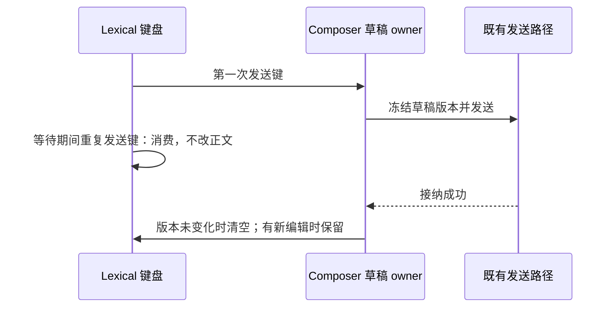

# Prompt Editor 复用说明

> **当前状态**：`ChatPromptEditor` 由 V4 主 composer 和 V4 用户消息编辑态共同复用。

`ChatPromptEditor` 是聊天输入框的轻量共享编辑器，负责承载 `LexicalChatInput`、提交/取消按钮、可选快捷入口和 workspace file drop。主输入区和用户消息编辑态都通过它复用输入核心。

主 `packages/ui/src/v4/ConversationComposer.tsx` 保留 session 级能力，例如 toolbar、prompt enhance、附件选择和停止生成；`ChatPromptEditor` 只处理通用编辑能力。用户消息 edit 由 `packages/ui/src/v4/ConversationRowView.tsx` 使用同一 editor inline 替换原气泡，只展示原文编辑、取消、提交、附件只读展示和 file mention 拖拽插入。

workspace file tree 拖拽追加 mention 的逻辑集中在 `workspaceFileComposer`，避免主 composer 和 edit composer 分别拼接 markdown，保证 `@file` mention 语义一致。

## 提交等待期间的键盘行为

发送快捷键在提交不可用时仍是发送动作：消费按键，不重复提交，也不退化为换行。连续两次
Enter 不得因第二次插入换行而改变草稿版本，导致成功发送的原文留在输入框。
用户主动选择的换行（默认 Shift+Enter、改绑后的换行、手机远控 Enter）和普通编辑继续可用；
发送失败保留草稿，成功清理仍由 ConversationComposer 拥有，迟到成功不能清掉用户的新编辑。
Ctrl/Meta+Enter 的反向投递和自定义发送键使用相同门禁，不改变 IME 选词与 mention 面板行为。

