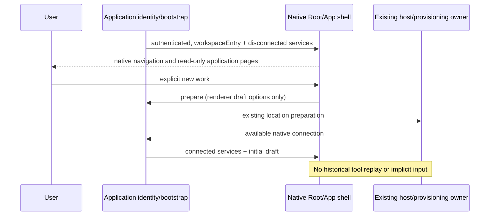

# Deferred workspace entry

The trusted application bootstrap may render the native Root before an execution connection exists. Root.workspaceEntry provides display content and one explicit prepare callback, using the same App, sidebar, responsive layout, account and application-page providers. No placeholder workspace path, session or accepted input is created. Empty path means no attached workspace and must never be passed to a writable host.

Web reuses the existing disconnected home service adapter. Reads describe no attached host; file, project preparation and other writes reject. Login, rendering, application pages and history reads cannot request an execution instance. Only explicit user preparation continues the existing application bootstrap and native transport. Draft options remain renderer-local and are passed to the connected Root without sending input. The original isCurrent lease is rechecked before navigation.

Preparation presentation is cancellable UI state, not an execution grant. Unmount aborts outstanding checks; stale intent leases cannot navigate. Connected Desktop and ordinary unconfigured native Web keep existing behavior.

ApplicationPageContext.close closes its existing overlay, preserving underlying workspace and focus. Saved conversations appear in the existing native task section. The application provides one native history controller shared by rows and details, suppresses server duplicates already present in native session IDs and never fabricates workspace metadata or project membership. Selecting a row uses native messages and ChatPromptEditor in the existing main pane. There is no saved-version detail page or second history navigation. Conflicts explain actual content and ask for the necessary choice in the conversation. The sidebar remains visible; task switching retains per-session unaccepted drafts. Continuation option queries and preparation begin only after explicit follow-up submission (or an explicit conflict choice in an attached session), through the existing native continuation owner. A sole confirmed candidate/target does not require a technical settings panel. Draft navigation verifies the same trusted identity before crossing Web reload, rechecks it on arrival and preserves text through the existing native composer store; it never auto-sends or overwrites a different nonempty draft. Legacy history links return to the root entry. History failures preserve a typed, display-only error for injected readError labels; service responses and credentials are never rendered. Successful retries clear the failure; identity/scope failures still clear the previous body.

Acceptance: authenticated root shows native shell without server-info, websocket or location discovery; historical read/failure/empty states do not prepare; explicit new work requests the existing location chain once; cancel/retry preserves boundaries; application history returns without reload or loop; Desktop current-session status stays in the native conversation. Check wide/narrow layouts, current light/dark themes, keyboard focus and permission failures.

The sidebar failure state is one compact, non-wrapping row: a localized loading-failure summary and refresh action. Do not expand permission/configuration troubleshooting text in task navigation. Typed failures and bounded diagnostics remain intact.

Native no-project preparation may allocate a distinct internal draft directory. Its trusted project-service owner registers that exact conversation purpose before returning it; UI paths or absent project membership do not grant sync eligibility. The existing task-index purpose table remains the only classification writer. Sync resolves each exact session to its native index workspace, refuses duplicate IDs, project roots, identity aliases and execution-directory overrides. Legacy internal draft rows remain blocked until explicit same-account attribution; only that native transaction records their purpose. No local-directory project is auto-enrolled.

Saved-status indicators occupy a compact icon in the native task title row, in both default and timeline layouts. They never add a second status-text row; hover and accessible names retain the exact saved/conflict meaning. The same indicator is used by supplemental saved rows.
