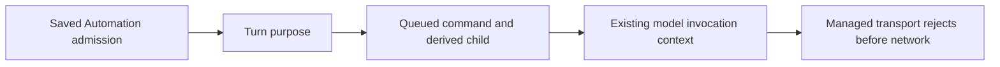

# Application-managed providers

An application may publish a user-scoped built-in provider release through the
private Node deployment option `ZCODE_APPLICATION_PROVIDER_CONFIG_FILE`.
An optional `ZCODE_APPLICATION_MODEL_CONFIG_URL` refreshes this same release with
the existing remote synchronizer and file lease, every five seconds. Its private
workload token is never attached to another origin or redirected response.
Provider Config remains the single directory owner; the existing file source
watches the release, and Personal Config remains separately editable.

Managed providers use group `application-managed` and an API-key access sentinel
`application-managed`. The sentinel grants no access. The release contains no
token, account key, authentication headers or customer content. Application
authorization and live model/key decisions remain at the application service.

The native adapter obtains a workload token only from private process environment
`ZCODE_APPLICATION_MODEL_TOKEN`. It must verify the exact configured base URL
against `ZCODE_APPLICATION_MODEL_BASE_URL` before sending credentials. No personal
provider may use the managed group. Changing a managed endpoint fails closed.
Node-to-Agent environment forwarding preserves these private variables without
putting them into RPC provider snapshots or model configuration.

```mermaid
sequenceDiagram
  participant A as Application resource owner
  participant P as Native Provider Config
  participant E as Native Agent adapter
  participant S as Application model service
  A->>P: Safe user-scoped release (atomic file)
  P->>P: Existing source watch and registry update
  P->>E: Frozen provider/model configuration
  E->>E: Verify endpoint; bind private workload token
  E->>S: Standard provider request
  S->>S: Recheck current identity, model grant and key owner
```

An unavailable or removed model never silently changes a saved model selection.
New application defaults apply only when no selection has been saved. Desktop
continuous streams and mobile replay retain the existing native owner and event
sequence; this extension adds no execution state or secondary session storage.
The optional release `applicationDefault` names a configured default. Managed
provider IDs use the `application:` namespace; an unavailable application default
has no Registry fallback. Revisions cover retained policy rows and their changes.

Acceptance: no private token in provider snapshots; personal providers retain
their configured keys; a managed endpoint mismatch or missing token fails before
network I/O; standard tool, usage and streaming semantics use existing adapters.

Desktop application authentication uses a Main-owned loopback transport when
`ZCODE_APPLICATION_MODEL_REMOTE_BASE_URL` and `...REMOTE_CONFIG_URL` are configured.
Main checks a private native workload token, reads the current application Cookie
from Electron's session, and forwards only model/configuration paths to the fixed
application origin. The native process never receives the application Cookie.
Login changes and logout affect the next request; they cannot reuse the previous
person's account key. Configuration delivery gets a Main-owned increasing revision
across identity switches. This is transport delivery sequence, not model authority.
The application origin, cookie names, CSRF header and loopback broker port come
from private deployment configuration, not Renderer input.

When a managed provider is present, the native selector shows its models as a
direct system-model list, followed by a separate direct custom-model list. Custom
rows retain provider badges and exact encoded selection values. Without an
application provider the existing native groups remain unchanged. Chinese and
English section labels follow the native Intl context.

Both sections remain visible when empty. The custom section offers the existing
provider settings action, including before a personal provider is configured;
it never creates a provider or copies application credentials. Application rows
may display configured brand artwork. The composer displays the selected system
model name without repeating the application provider name. The application
release assigns each system model one stable supported protocol, rather than
presenting protocol aliases as duplicate models; personal selections remain
separate even when model names match. The menu scrolls within the available
viewport and keeps its management actions reachable on mobile and desktop.

Application workload credentials supplied by the interactive host are not
Automation credentials. When this private application transport is configured,
Automation must reject a fixed or newly resolved `application:` model selection
before fixing its run model or creating/resuming a task. It must not silently use
the logged-in person's cookie or employee key for a scheduled/manual rule.
Ordinary personal-provider Automation keeps its native behavior. Dedicated
application Automation identities and credentials require a separate explicit
contract before this gate is opened.

Acceptance: a new Automation and a previously fixed run using an application
provider both fail before task creation, resume or prompt; the same private host
can still dispatch an Automation explicitly selecting a personal provider.

The model transport also enforces this restriction on every physical request.
Core records the trusted current turn's Automation purpose in runtime-only
`ModelInvocationContext.modelRequestPurpose`, captures it before queuing a derived
command, and retains it on child model handles. Subagent and workflow choices
cannot grant access to the interactive application's credentials. The purpose is
not a provider setting, RPC secret, session preference or user text. Completion
does not change a later human turn's purpose; already derived background work
retains its restriction. Existing retry/concurrency admission remains unchanged.
Workflow runs retain the restriction in their existing `run-launched` journal
metadata; cold resume and amend inherit it through the original launch anchor.
The engine records this opaque host provenance and does not interpret credentials.
Earlier records carrying the native canonical Automation input ID retain the
same restriction when read, as with existing native queued-turn attribution.



Acceptance: a personal-provider Automation cannot invoke an application provider
through a subagent or workflow child, including queued and streamed calls and
handles created before the turn. Personal-provider requests continue; a later
human turn in the same session can use its own application provider.
