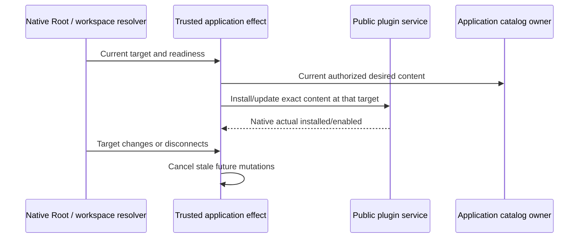

# Application plugin location effects

Trusted application assembly may supply `renderLocationEffect` on the existing
application plugin store section. Root mounts this optional effect through the
same `ApplicationPageContent` workspace/service resolution used by application
pages, independently of opening the marketplace. With no extension, native
behavior is unchanged.

The callback receives only the current workspace target and RPC readiness. It
does not gain another installation store or execution controller. The application
uses public plugin services for reconciliation and cancels stale work when the
workspace, remote session, identity or readiness changes. A disconnected remote
location must never resolve to local installation.

Acceptance: effect mounts outside marketplace navigation; absent extension has
no effect; the existing resolver supplies workspace identity and remote session;
stale targets stop mutation; enabled choices stay native-owned. Application
reconciliation must use immutable package revisions so existing runs retain their
previous native package paths. Desktop and web use this same projection; this
extension adds no execution transport, queue or recovery state.
