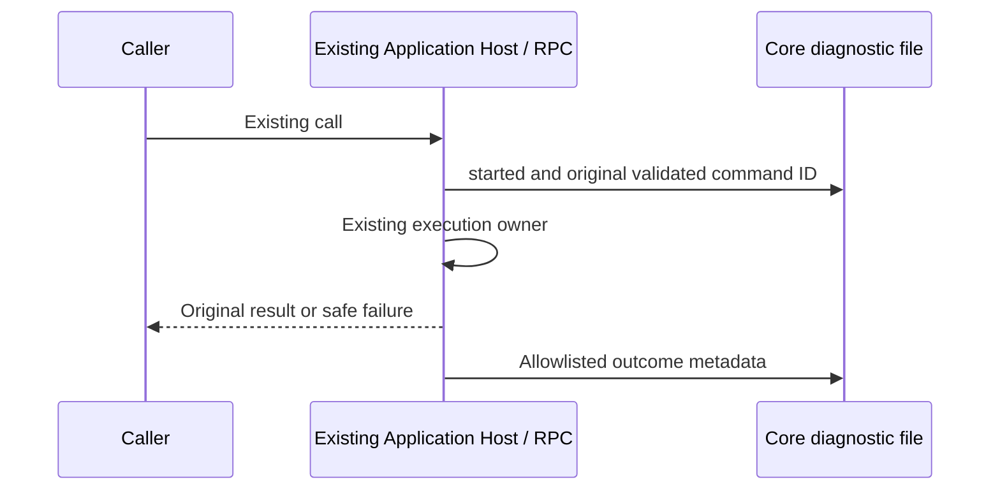

# Server Core diagnostics

The Server Core owns a bounded local diagnostic file under its existing private
server run directory. General Core stdout/stderr remain disconnected: enabling
operational diagnostics must not persist arbitrary console output, RPC arguments,
extension return values, errors, stack traces, messages or credentials.

Application Host calls and private controls emit `started` before awaiting the
extension and `completed` / `failed` with the same generated correlation ID,
validated method and elapsed milliseconds. Only the exact `input.commandId` and
`input.sessionId` fields may be copied, each after complete UUID validation at the
Host and file sink; no arbitrary input projection is allowed. A stalled call must
still leave its start evidence. Initialization and disposal
retain lifecycle outcomes. The existing RPC logging middleware remains the timing
owner; Core promotes only its bounded channel/method/failure metadata to warning.
Desktop continuous and Web replayable connections retain their current owners and
delivery semantics. Diagnostics do not retry or alter a call.

The Core writes asynchronously in one bounded queue. Each file is at most 1 MiB,
with two retained rotations and at most 64 KiB queued; overflow is counted in a
safe summary. File IO failure never changes business results. Shutdown attempts a
bounded flush before process exit. Rotation closes each append before rename so
the same implementation works on Windows, macOS and Linux. New directories and
files use owner-only POSIX permissions; no shell, symlink target or environment
secret is used as a log destination.

Validation covers metadata-only capture with secret-bearing input/error fixtures,
success and failure timing, RPC failure warning versus debug success, file and
queue bounds, rotation, flush and an unwritable destination. Existing Core startup
and shutdown tests must continue to pass.
